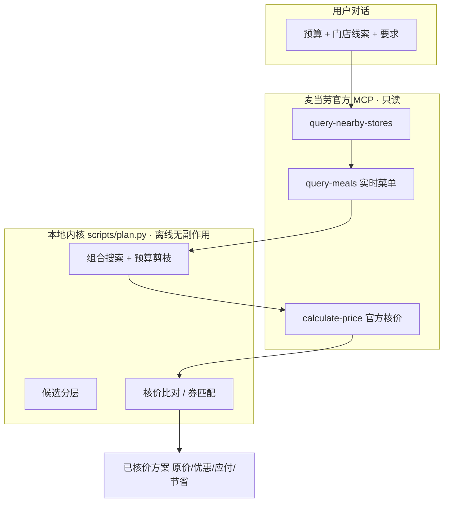

# 麦麦预算点餐师 · McDonald's Budget Meal Planner


> 告诉我预算和你想要的餐，我用麦当劳官方 MCP 拉取**实时菜单**、在本地搜索组合、再用官方 `calculate-price` **核价**，给你 2–3 个**经过核价**的方案。

> **这是一个 WorkBuddy Skill，不是网站、不是 Web App、不是点餐平台。** 交互全部发生在 WorkBuddy 对话中——不建前端、不建数据库、不做账户体系。

> 参赛作品：麦当劳开发者创新挑战赛 · 赛道为「麦当劳官方 MCP」应用。

---

## 目录

- [它解决什么问题](#它解决什么问题)
- [核心功能](#核心功能)
- [项目展示](#项目展示)
- [使用示例](#使用示例)
- [工作原理](#工作原理)
- [安全与限制](#安全与限制)
- [技术实现](#技术实现)
- [安装与使用](#安装与使用)
- [测试情况](#测试情况)
- [当前限制（详细说明）](#当前限制详细说明)
- [参赛与声明](#参赛与声明)
- [许可与目录结构](#许可与目录结构)

---

## 它解决什么问题

在麦当劳点餐时，「预算 X 元、必须有个汉堡、最好再来杯饮料」这种搭配，靠人翻菜单心算既低效又容易超预算：

- **价格会动**：同一商品在不同门店、不同时段价格不同，还可能是「需随单购会员卡才成立」的条件价。
- **组成看名字不够**：名字像套餐的未必含汉堡，名字不含「堡」的反而可能含汉堡；套餐默认组成必须逐条核实。
- **硬性要求 vs 软偏好混为一谈**：「必须有饮料」和「最好有饮料」是两回事，混用会静默降级。
- **优惠券不能想当然**：未领取的券在领取前官方不返回优惠金额与适用商品，没法提前判断能否省钱。

本项目把「菜单查询 → 组合搜索 → 官方核价」交给麦当劳**官方 MCP**，给出的价格不是估算，而是官方接口算出来的。

---

## 核心功能

### 区分「必须满足」与「尽量满足」

| 类别 | 内容 | 说明 |
|---|---|---|
| ✅ 必要条件（硬约束） | 必须含汉堡、可额外要求「必须有饮料 / 必须有小食」 | 不满足的组合会被**整组丢弃**；「必须有饮料」用 `--require-drink`，不得用 `--prefer-drink` 顶替 |
| 🟡 可选偏好（软偏好） | 最好有饮料 / 最好有小食 | 只影响排序打分，**不保证**结果里真的出现 |
| 🔄 实时菜单 | 查询指定门店**实时到店菜单** | 每次运行重新拉取，不缓存、不硬编码价格 |
| ✅ 官方核价 | 对每个候选调用官方 `calculate-price` | 价格唯一权威来源；菜单现价不直接当成交价 |
| 🛑 无解处理 | 解释原因 + 给出最小调整建议 | 只放宽可选偏好，**绝不擅自取消「必须有汉堡」** |

> 已知取舍：第一版内核以「已确认含汉堡」商品为锚点，因此**无法表达「这餐不要汉堡」**；用户明确不想吃汉堡时必须如实说明，不会偷偷塞一个进去。

### 已实现 / 刻意不做

| 已实现（经过验证） | 说明 |
|---|---|
| 自然语言输入预算 / 门店 / 要求 | 缺预算、城市、门店关键词任一项时会反问，不猜测 |
| 查询门店（城市 + 关键词） | 实测无城市+关键词无法解析门店 |
| 获取指定门店**实时到店菜单** | 价格的唯一来源 |
| 硬性条件：必须含汉堡 | 只认 `confidence=confirmed_detail` 且默认含堡的商品 |
| 可选偏好：饮料 / 小食 | 软偏好，只影响排序 |
| 预算内组合搜索（本地、离线、可复现） | 纯标准库，无副作用 |
| 官方 `calculate-price` 核价 | 返回原价 / 优惠 / 应付 / 节省四值 |
| **只读**盘点已有券 / 本店可用券 / 未领取券 | 真实券样本仍为空 |
| 券与组合的编码级匹配 + 探针剪枝 | 离线，有测试 |
| 输出 2–3 个已核价方案 | 只输出 `verified[]` 中的方案 |
| 无解时解释原因 + 最小调整建议 | 如实，不凑数 |

| 刻意不做（不实现、不承诺） |
|---|
| 外送 / 得来速 / 团餐 |
| **自动领券（默认关闭，且不可撤销）** / 自动下单 / 支付 / 积分 / 会员 |
| 套餐拆解与特调 / 营养与过敏原筛选 / 多人分餐 / 用户历史 |
| 独立网页或应用 |

---

## 项目展示

### 一次真实输出（节选）

> 数据来自 **2026-10-16 实测**（门店 麦当劳大连华南餐厅 `storeCode=3230019`，到店自取）。这是真实核价结果，非模拟界面。

```
根据你选择的门店（麦当劳大连华南餐厅，storeCode=3230019）和 ¥25 预算，
我找到了以下经过官方核价的方案。渠道：到店自取。

方案 A：多品类
- 商品组合：大堡口福三件套 ×1
- 官方核价：¥23.90
- 剩余预算：¥1.10
- 满足的要求：汉堡、饮料、小食

方案 B：省钱
- 商品组合：牛肉堡单品精选 ×1
- 官方核价：¥14.00
- 剩余预算：¥11.00
- 满足的要求：汉堡
```

完整测试记录见 [`tests/TEST_RESULTS.md`](tests/TEST_RESULTS.md)。

### 工作流程


---

## 使用示例

直接用自然语言说，**不需要提 Skill 名字**：

```
帮我用 25 元点一顿麦当劳，必须有汉堡。我在大连，门店关键词"体育中心"。
```

```
我有 35 元，想吃汉堡，最好有饮料。城市大连，关键词滨湖。
```

```
预算 40 元，必须有汉堡和饮料，给我三个方案。大连，关键词星海广场。
```

```
我只有 10 元，但是必须有汉堡，有没有办法？
```

```
我预算不变，想要汉堡、饮料和小食，帮我看看怎么搭配。
```

### 一次真实输出（完整结构，2026-10-16 实测）

> 以下为真实核价返回的节选；金额四件套（原价 / 优惠 / 应付 / 实际节省）是硬性输出要求，一律照抄官方 `calculate-price` 返回，不自行推算。

```
方案 A：多品类
- 商品组合：大堡口福三件套 ×1
- 原价：¥23.90    优惠金额：¥0.00（未用券）
- 应付金额：¥23.90    实际节省：¥0.00
- 剩余预算：¥1.10    满足的要求：汉堡、饮料、小食

方案 B：省钱
- 商品组合：牛肉堡单品精选 ×1
- 原价：¥14.00    优惠金额：¥0.00（未用券）
- 应付金额：¥14.00    实际节省：¥0.00
- 剩余预算：¥11.00   满足的要求：汉堡

---
核价门店：麦当劳大连华南餐厅（storeCode=3230019）
使用渠道：到店自取（orderType=1, beType=1）
核价工具：calculate-price（官方 MCP），核价时间 2026-10-16
尚未验证的信息：饮料/小食分类来自名称兜底规则；映射表只覆盖 49/106 个商品；
                 本账号尚无优惠券样本，券路径未经真实核价验证
```

---

## 工作原理



**一句话流程**：自然语言请求 → 槽位解析（预算 / 城市 / 门店关键词 / 偏好）→ 门店与实时菜单查询 → 本地候选组合搜索 → 官方 `calculate-price` 核价 → 返回 2–3 个已核价方案（或如实说明无解）。

本地内核 `scripts/plan.py` 是**离线、无副作用**的：不联网、不下单、不支付、不领券。所有真实价格都来自运行时对官方 MCP 的调用。

复现本地校验：

```bash
python3 scripts/plan.py selftest                                   # 30 项自检
python3 tests/test_plan.py                                         # 1119 项（组合搜索/核价/来源追踪/编码轮换/条件价预筛/候选分层/跨时段/硬约束）
python3 tests/test_coupons.py                                      # 87 项（优惠券）
python3 tests/test_product_map.py                                  # 437 项（商品映射）
```

---

## 安全与限制

- **只读、不写**：本 Skill **不自动领券、不创建订单、不支付、不兑换积分、不新增地址**。券盘点均为只读接口。
- **价格随门店与时间变化**：核价记录**不可跨店/跨时段搬用**；仓库里的测试快照只是历史记录，运行时一律重新拉取。
- **菜单「现价」可能是条件价**：需随单购会员卡才成立的价格不会直接当作成交价，预算预筛已做处理（详见 `references/menu-price-semantics.md`）。
- **不承诺营养或过敏原结论**：「丰富度」是本产品自定义的排序规则（件数 / 类别覆盖 / 预算利用率），**不是**营养学结论；不声称「全网最低价」「最划算」。
- **未验证即如实说明**：优惠券真实核价、外送/得来速/团餐、套餐子项替换等均未验证，不会描述为已可用。

---

## 技术实现

| 技术点 | 实现方式 |
|---|---|
| **WorkBuddy Skill** | `SKILL.md` 声明触发词与工作流；交互在对话中完成，无前端 |
| **麦当劳官方 MCP** | 只读调用 `query-nearby-stores` / `query-meals` / `calculate-price` 等官方工具 |
| **商品映射 `references/product-map.json`** | 已确认组成的商品映射（**不含价格**）；逐条 `query-meal-detail` 核实并留证据，编码轮换时标记 `retired` |
| **组合搜索内核 `scripts/plan.py`** | 纯标准库、离线、无副作用；候选分层优先占满「价格可判定」席位 |
| **价格核验** | 每个候选交给官方 `calculate-price`；区分「不带券基线」与「带券试算」，只把 `verified[]` 称为「已核价」 |
| **券匹配（离线）** | 按商品编码交集匹配；未领取券不可评估，查询失败不等于没有券 |

参考文档：`references/category-rules.md`（分类规则与维护）、`references/menu-price-semantics.md`（条件价与预筛语义）、`references/coupon-schema.md`（券结构）、`MCP_INTEGRATION.md`（实际使用的 MCP 工具与调用流程）。

---

## 安装与使用

### 1. 配置麦当劳 MCP

1. 申请麦当劳 MCP Token（入口见官方仓库 <https://github.com/M-China/mcd-mcp-server>）；
2. 打开 WorkBuddy → 左侧边栏【专家·技能·连接器】→【连接器】→ 右上角【自定义连接器】→【配置MCP】；
3. 粘贴 `mcp-config.example.json` 的内容，把 `${MCD_MCP_TOKEN}` 换成你的真实 Token；
4. 回到【自定义连接器】，把 `mcd-mcp` **启用**。

也可以直接写入 `~/.workbuddy/mcp.json`：

```json
{
  "mcpServers": {
    "mcd-mcp": {
      "type": "streamablehttp",
      "url": "https://mcp.mcd.cn",
      "headers": { "Authorization": "Bearer ${MCD_MCP_TOKEN}" }
    }
  }
}
```

> ⚠️ 本仓库**不含**任何真实 Token。`mcp-config.example.json` 只使用环境变量占位符。

### 2. 安装 Skill

```bash
# 用户级（所有项目可用）
ln -s "$(pwd)" ~/.workbuddy/skills/mcd-budget-meal-planner

# 或项目级
mkdir -p .workbuddy/skills && ln -s "$(pwd)" .workbuddy/skills/mcd-budget-meal-planner
```

### 3. 环境要求

- Python 3.8+（仅用标准库，无第三方依赖）
- 已启用 `mcd-mcp` 连接器

---

## 测试情况

所有数字均来自**实际运行**，未执行的测试一律标记为「未验证」，不伪造成功。

| 类型 | 命令 / 场景 | 结果 |
|---|---|---|
| 本地自检 | `scripts/plan.py selftest` | **30/30 通过** |
| 本地自动化 | `tests/test_plan.py` | **1119/1119 通过** |
| 本地自动化 | `tests/test_coupons.py` | **87/87 通过** |
| 本地自动化 | `tests/test_product_map.py` | **437/437 通过** |
| 在线端到端（真实 MCP） | 测试 A–H（25/35/40/10 元、缺参、未知组成、核价失败、超预算） | 全部通过，金额均来自真实 `calculate-price` 返回 |

**测试数据来源区分：**

- **真实 MCP 验证（到店链路）**：门店 → 菜单 → 餐品详情 → 核价全链路；56 个映射条目的组成（逐条 `query-meal-detail`，含 `evidence.at` 与 `storeCode`，其中 7 个已 `retired`）；时段切换行为；商品编码轮换（7 组）；条件价字段语义（26 条裸核价 == 原价，覆盖午餐与早餐两个时段）。
- **离线 / 合成样本**：券归一化、有效期判定、编码级匹配、探针剪枝、实际节省计算等，使用**明确标注来源**的样本（真实空返回 / 结构样本 / 合成，见 `tests/fixtures/coupons/README.md`）。
- **历史快照**：`tests/fixtures/menu_plan_fixture.json` 为真实菜单快照（2026-10-16T11:55:12，106 项），仅用于回归，运行时会被真实拉取替换。

**尚未验证（如实列出，不得描述为已可用）：** 真实带券核价（账号券包为空）、自动领券（从未调用且不可撤销）、创建订单 / 支付、`query-order` / `cancel-order`、外送 / 得来速 / 团餐、套餐子项替换 / 特调 / `quantity>1`、蛋白偏好筛选（"只要牛肉堡 / 不要鱼堡"）。

完整记录见 [`tests/TEST_RESULTS.md`](tests/TEST_RESULTS.md)。

---

## 当前限制（详细说明）

<details>
<summary>点击展开：覆盖度、时段、编码轮换、条件价、门店差异等 15 条技术细节</summary>

1. **只支持到店自取**（`orderType=1`, `beType=1`）。外送与得来速未实现。
2. **商品映射表覆盖 49/106 个商品（46.2%）**。其余 51 个未覆盖 + 6 个明确排除（周边/玩具/非食品），一律被视为「未知组成」，**不会**用于满足「必须含汉堡」。
3. **菜单随时段整体切换。** 早餐 / 午餐 / 下午茶 / 夜市 / 宵夜之间会整体换菜单；常规商品在早餐时段调用 `query-meal-detail` 会返回 `60001 未匹配到商品`——这是**时段问题**，不得据此判定映射失效。
4. **商品编码会轮换。** 同一次切换中实测到 7 个编码被替换，其中 3 个**同名但默认组成已变**。旧编码在映射表标 `retired` 并由 `build_pool` **强制排除**；新编码一律**独立核实、独立建条目**，不沿用旧结论。`60001` 因此有三个成因（时段 / 编码轮换 / 真失效）。
5. **价格是门店级 + 时段级的。** 实测同一商品在 `3230019` 与 `3230442` 价格不同，且部分商品编码在门店间不一致——**核价记录不可跨店搬用**。
6. **菜单「现价」可能是条件价（已修复预筛）。** `discountType` 为「随单购麦金卡优惠」的商品，菜单现价 ≠ 裸核价（如 `9900000890` 菜单 ¥28、实付 ¥58）。预算预筛改用 `prefilterPriceYuan`（原价），实测 26/26 裸核价 == 原价，覆盖午餐与早餐两个时段。
7. **候选分层（P1.10）**：无法本地判定价格的候选不再与可信候选抢席位；未定价候选仍**不被剪枝**（「未知 ≠ 超预算」）。
8. **`takeWayList` 随门店变化**：`3230019` 返回 `eat-in` + `take-in-store`，`3230442` 返回 `eat-in` + `locker-in`（取餐柜）。取餐方式必须取当前门店核价返回。
9. **优惠券路径尚未用真实券验证。** 本账号券包与门店券官方返回都是空的，因此「真实带券核价」**仍未验证**。⚠️ 2026-10-16 11:00 那批核价出现真实 `discount > 0`，但那是**店内促销自动生效**（如 `521986` 原价 ¥16 → 促销价 ¥11），**不是券**，不得当作「券链路已打通」。
10. **未领取券无法提前评估。** `available-coupons` 不返回 `couponId`/优惠金额/门槛/适用商品，所以「领券前判断它能否省钱」在当前接口下做不到。
11. **饮料/小食的分类来自名称兜底规则**，未逐条调用 `query-meal-detail` 核实。它们只用于满足**可选偏好**，不参与硬性条件。
12. **「堡」包含鱼堡，但不支持蛋白偏好筛选。** 菜单把牛/鱼/肉同列为「堡」，所以 `双层深海鳕鱼堡`、`鱼排堡` 也算汉堡。但「只要牛肉堡 / 不要鱼堡」这类偏好**当前无法筛选**。
13. **套餐按整份参与组合**，不支持拆解或替换子项；**需要用户多选的套餐**（如「堡堡随心拼」）一律不参与硬性条件。
14. **价格随门店与时间变化**。仓库里的测试快照只是历史记录，运行时一律重新拉取。
15. **「丰富度」是本产品自定义的排序规则**，不是营养学结论；不承诺「全网最低价」或「最划算」。

### 哪些是已验证的，哪些不是

**已用真实 MCP 调用验证（到店链路）**：门店 → 菜单 → 餐品详情 → 核价全链路；`calculate-price` 返回字段解析；组合搜索与预算约束、核价失败与超预算的拒绝、无解提示、映射表对已知反例的排除；56 个映射条目的组成（含 7 个 `retired`）；第六/七批补齐的「名称含堡」商品（锚点 25 → 43）；时段切换行为；商品编码轮换（7 组）；条件价字段语义（26 条裸核价 == 原价，跨午餐与早餐）；首个真实 `discount > 0`（店内促销，非券）；券查询接口的真实返回（均为空）。

**只在离线测试中验证（用标注来源的样本）**：券归一化、有效期判定、编码级匹配、探针剪枝、实际节省计算、带券核价失败的处置。

**尚未验证**：真实带券核价（券参与的真实降价；促销产生的 `discount > 0` 不算）、券能否叠加/重复、自动领券、创建订单 / 支付 / `query-order` / `cancel-order`、外送 / 得来速 / 团餐、套餐子项替换 / 特调 / `quantity>1`、未列入映射表的商品、蛋白偏好筛选。

</details>

---

## 参赛与声明

本项目为**麦当劳开发者创新挑战赛**参赛作品，由参赛者独立开发，**非麦当劳官方产品**。

- 官方参赛声明原文（一字未改，SHA 前缀 `cd28101b`）见 [`CONTEST_DECLARATION.md`](CONTEST_DECLARATION.md)。
- 报名 Issue：[M-China/mcd-developer-innovation-challenge #798](https://github.com/M-China/mcd-developer-innovation-challenge/issues/798)
- 仓库地址：<https://github.com/Harrrrvey/mcd-budget-meal-planner>

项目输出仅供参考，不构成医疗、营养或其他专业建议；餐品信息、价格及供应状态以麦当劳官方渠道的实时结果为准。本项目**不执行**任何下单、支付、领券、积分兑换等会改变账户状态的操作。

---

## 许可与目录结构

**许可**：MIT（见仓库 [`LICENSE`](LICENSE)）。

```
.
├── SKILL.md                      # Skill 入口（触发与工作流）
├── README.md                     # 本文件
├── MCP_INTEGRATION.md            # 实际使用的 MCP 工具与调用流程
├── CONTEST_DECLARATION.md        # 参赛声明（官方原文，未改动）
├── mcp-config.example.json        # 脱敏的 MCP 配置示例
├── workbuddy.md                  # WorkBuddy 开发对话上下文（事实记录）
├── assets/
│   └── cover.svg                 # 项目封面（原创，无品牌标识）
├── references/
│   ├── product-map.json          # 已确认组成的商品映射（56 条，7 条 retired，不含价格）
│   ├── category-rules.md          # 分类规则、已知陷阱、维护方式
│   ├── menu-price-semantics.md   # 菜单价格字段语义（条件价）与预筛规则 + 实测证据
│   └── coupon-schema.md          # 券的数据结构 / 状态枚举 / 匹配规则 / 金额单位
├── scripts/
│   └── plan.py                   # 组合搜索 + 券匹配 + 核价比较内核（离线、无副作用）
└── tests/
    ├── fixtures/
    │   ├── menu_plan_fixture.json    # 真实菜单快照（2026-10-16T11:55:12，106 项）
    │   └── coupons/                  # 券样本（真实 / 结构样本 / 模拟，来源见其中 README）
    ├── test_plan.py              # 组合搜索与核价测试（1119 项）
    ├── test_coupons.py           # 优惠券测试（87 项）
    ├── test_product_map.py       # 商品映射专项测试（437 项）
    └── TEST_RESULTS.md           # 真实测试记录
```
